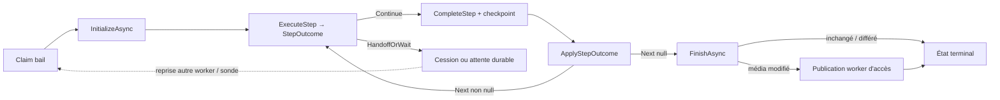

# Runtime : exécution, intégrité et publication

Un worker exécute une **version publiée précise** d'un flow, de bout en bout, sur un seul worker par défaut. Le modèle de flow est dans [flows.md](flows.md), les plugins dans [plugins.md](plugins.md).

## Organisation de l'exécution worker

- `RuntimeFlowRunner` (singleton) ne porte **aucun** état de marche : il crée une `RuntimeFlowExecution` par bail.
- L'état de graphe et de workspace vit dans `FlowExecutionState` (position `Next`, fichier `Current`, `Context`/`Variables`, empreintes, materialisation, publication confirmée). Les champs de bail (`Revision`, perdu, annulé) ne mutent que via des méthodes thread-safe ; le renouvellement les applique sous `leaseGate`.
- Chaque étape retourne un `StepOutcome` (`Continue` / `HandoffOrWait` / `Fail`). Un seul applicateur met à jour `FlowExecutionState` à partir de l'outcome ; la clôture locale (`FinishAsync`) n'a lieu qu'après un parcours `Continue` jusqu'à `Next == null`.
- Fichiers : `RuntimeFlowExecution.cs` (cycle de vie, bail, préparation), `RuntimeFlowExecution.Steps.cs` (boucle et familles d'étapes), `RuntimeFlowExecution.Steps.Operations.cs` (opérations média).

## Registre des exécutions
- États : `queued`, `running`, `cancelling`, `succeeded`, `failed`, `cancelled`. Une transition et son événement sont écrits dans la même transaction ; rapports idempotents (identifiant d'événement + révision attendue) ; transitions terminales figées. Annulation en cours = demande confirmée après arrêt des processus. Une relance conserve l'échec et crée une tentative liée (une seule relance concurrente).
- L'historique, les tâches et les baux sont dans la base du central ([storage.md](storage.md)). Dans les compteurs et aperçus « en cours », une exécution locale n'est active que si elle est `running`, possède un worker avec un bail non expiré ; une annulation demandée, une file d'attente ou une absence de bail ne sont pas comptées comme traitement confirmé. `GET /api/v1/executions` (≤ 200, traitements confirmés d'abord), `…/{id}/events`, `…/{id}/pipeline` (étapes, commandes, sorties tronquées à 32 Ko, secrets masqués ; stdout/stderr des scripts et plugins exclus).
- Création uniquement depuis une bibliothèque (version de flow attribuée), jamais avec une définition arbitraire.
- `GET /api/v1/activity/files` rassemble l’inventaire `library_media` avec l’état d’exécution le plus récent du flow actuellement attribué, ses compteurs et une pagination filtrable par texte, bibliothèque, flow et worker. Les états UI distinguent à traiter (aucune tentative terminée ou tentative en file), actif, terminé (réussite ou report), erreur/annulation/quarantaine et traitement désactivé. Les exécutions annulées et les tâches en quarantaine sont visibles avec les erreurs pour permettre leur diagnostic et leur remise en file ; une tentative source réellement en file sans conflit reste « à traiter ». Une tentative en file est affichée avant une ancienne annulation en quarantaine du même média.
- `GET /api/v1/executions/{id}/pipeline` récupère les audits historiques de commandes et d’opérations sous forme de tableau JSON. Les opérations exposent leur durée et le volume d’octets ; elles distinguent outils exécutés, transferts d’artefacts, scans et publication disque. Les anciens tableaux adjacents sont réunis et dédupliqués ; un audit illisible produit `command_log_unreadable` sans faire échouer le pipeline.

## Sondages sans travail
- La récupération des baux et l’évaluation des attentes vérifient d’abord en lecture seule s’il existe des candidats. Sans candidat, aucune transaction d’écriture n’est ouverte. Les prédicats sont revérifiés dans la transaction avant toute décision ; un travail apparu après la prélecture est traité au passage suivant. La vérification des sources inaccessibles et celle des destinations de relais restent exécutées.

## Attribution, baux, reprise
- Chaque serveur attribue **uniquement** les travaux de sa base locale, en transaction d'écriture immédiate. Le worker doit être présent, accepter du travail ([workers.md](workers.md)), avoir une place, les outils et encodeurs vérifiés, les versions exactes des plugins et un accès direct ou par transfert. Segments : `nodes-run-on-node`, `nodes-require-capability`, `nodes-require-direct-access` (strict ou préférence) contraignent le worker d'un segment.
- Le placement multi-workers de l'ADR [0024](../adr/0024-choix-du-noeud-avant-execution.md) préfère un worker compatible à accès direct, puis un worker capable de tout le flow avec transfert, puis une affectation segmentée minimisant exactement les changements de worker sur les arcs possibles. Le worker persiste le plan après le claim et sous le bail, dans une opération distincte ; le premier rapport de métadonnées peut l'affiner une fois, après détermination des conditions média. Le plan est ensuite réutilisé aux checkpoints et reprises de la même exécution ; une nouvelle tentative depuis l'entrée recalcule son plan. Le chemin de claim ne persiste aucun plan. Les branches inconnues restent conservatrices ; au runtime seule la branche choisie est suivie. Une affectation impossible produit `placement_impossible` et aucune destination imposée ne fait l'objet d'un repli silencieux.
- Quand le plan est affiné après le claim ou persisté pour une exécution déjà sous bail, le calcul de capacité exclut cette exécution du nombre de tâches actives du worker. Elle occupe déjà son propre créneau ; la compter une seconde fois pouvait transformer un worker direct à capacité 1 en placement impossible pendant sa préparation.
- Un claim parcourt les candidats par pages de 100, dans l'ordre stable `(queued_at,id)`, jusqu'à attribution ou fin de file. Les 100 premiers incompatibles n'empêchent plus un worker de prendre une tâche compatible plus loin. Chaque page termine sa transaction avant la suivante ; présence, calendrier, capacités, plafonds, accès et réservation sont revérifiés sous transaction. Le curseur n'est valable que pour cet appel et l'annulation arrête la recherche ; les tâches apparues derrière le curseur sont réexaminées au prochain appel. La migration additive 0051 indexe cet ordre.
- Bail 180 s renouvelé toutes les 15 s, **époque** croissante, réservation unique par bibliothèque/chemin. Tout rapport, renouvellement, transfert et publication vérifie époque et expiration ; un ancien worker est refusé (409). Checkpoint et événement dans la même transaction.
- **Motif des refus d'étape.** Un 409 sur `steps/start` ou `steps/complete` porte `{"reason":"<code>"}` (codes stables de `StepRefusalCodes` : `lease_epoch_mismatch`, `artifact_missing`, `next_node_mismatch`, `direct_source_not_allowed`, `revision_conflict`…) et le central journalise le refus en Warning avec exécution, nœud, worker et époque. Le worker reprend le code dans l'échec `cluster_refused : … (motif : <code>)`. Ne jamais renommer un code existant ; en ajouter un pour tout nouveau refus.
- **Perte du worker** ([ADR 0044](../adr/0044-echec-apres-perte-de-bail.md)) : la tentative échoue avec la raison `worker_perdu` (préfixe du détail) et le code d'échec stable `failure.code = "worker_lost"` (#26 ; avant, le code générique `execution_failed`), les réservations et verrous de disque sont libérés ; les artefacts et la source sont conservés, **aucune réattribution silencieuse sous le même identifiant**. Reprise = nouvelle exécution depuis l'entrée, manuelle ou par `nodes-retry-on-worker-loss` (1 à 10 tentatives, cible worker/groupe/étiquettes), refusée automatiquement si une étape du précédent essai est non idempotente. Un script ou plugin interrompu avant son checkpoint a un effet incertain : échec + relance explicite.
- **Mise à niveau** : une reprise automatique héritée encore en attente (`resume_count > 0`, `handoff_pending`, aucun worker assigné) est exclue du claim dès le démarrage, puis clôturée par la récupération même sans bail expiré. Ses réservations et verrous sont libérés ; les artefacts sont conservés. Aucune relance automatique n'est créée pour ces anciennes reprises : une action explicite doit créer une nouvelle exécution après vérification des effets antérieurs. Une annulation demandée reste une annulation ; les relais explicites sans reprise historique restent inchangés.
- Plafonds de traitement : global worker, global bibliothèque, couple worker/bibliothèque ; tous doivent autoriser ; maxima sans réservation ; diminuer une limite ne tue pas l'actif.
- Annulation : contrôlée avant chaque étape et pendant les processus externes ; confirmée seulement après arrêt de l'arbre de processus et nettoyage ; perte du bail interdit toute publication.

## Relais, attentes, verrous
- `nodes-require-capability` accepte un **type d'encodage** (`encoderKind`, plugin `nodes` 1.5.0) avec « Encodeur ou codec requis » : « Matériel » n'accepte que les encodeurs matériels (QSV, NVENC, VAAPI) utilisables sur le worker et exclut le CPU (`libx265` ne satisfait pas `hevc` en mode matériel) ; « CPU » n'accepte que les encodeurs logiciels ; « Peu importe » garde le comportement antérieur. Sans codec renseigné, tout encodeur du type choisi convient.
- Le type d'encodage « Selon le profil d'encodage du flow » (`encoderKind=profile`, plugin `nodes` 1.6.0) exige un worker qui a un encodeur **utilisable** parmi les cibles du profil de chaque bloc vidéo du flow. Si « Réessayer en CPU » est actif, un encodeur CPU du catalogue suffit aussi pour cette exigence, afin qu'un central sans accélérateur puisse encore exécuter le bloc. Le codec et l'encodeur du bloc sont ignorés ; sans bloc vidéo avec profil dans le flow, aucun worker n'est éligible.
- « Bibliothèque sur ce worker » accepte « Et pouvoir encoder avec le profil du flow » (`requireProfileEncoder`, plugin `nodes` 1.7.0) : le worker répond « Oui » seulement s'il a la bibliothèque en accès direct **et** une cible **déclarée** du profil. Le repli CPU ne rend pas cette réponse vraie : un worker qui n'a que `libx265` répond « Non » et peut prendre le flow pour le confier à un worker qui a la cible (relais « Tout worker éligible » suivi de « Exiger une capacité » selon le profil). Le repli s'exécute sur le worker qui encode, quand la cible matérielle échoue ou n'est pas utilisable au moment de la commande. La résolution CPU est acceptée si elle reproduit la cible catalogue (qualité par défaut, préréglage medium, priorité à la suite des cibles CPU du profil).
- `nodes-library-access` (plugin `nodes` 1.4.0) : condition « la bibliothèque est montée sur ce worker » (sorties `yes` / `no`). `yes` si le worker est le worker d'accès du fichier et en accès direct, `no` s'il a reçu une copie par transfert. Enchaînement type pour un encodage : `yes` → on encode sur place ; `no` → `nodes-handoff` (autre worker éligible) puis `nodes-require-capability` (encodeur voulu), le worker d'accès restant celui qui publie. Pour un remux ou un changement d'en-tête, `nodes-require-direct-access` en début de flow. Le worker d'accès reste celui de la première attribution après un relais entre workers ; un transfert de propriété entre serveurs sélectionne un agent local compatible à accès direct (ADR 0016).
- `nodes-handoff` : cède la suite à un autre worker (n'importe quel worker éligible, un worker précis, ou un groupe/des étiquettes ; le mode « serveur » est retiré, [ADR 0040](../adr/0040-vocabulaire-central-worker.md)) à un checkpoint durable, sous nouveau bail, même exécution, **même réservation** ; cible absente/occupée/incompatible = attente (jamais repli sur le précédent) ; fichiers identifiés par SHA-256 ; le worker d'accès de la bibliothèque reste fixé à la première attribution. Relais vers soi-même = pas de transfert. Un worker n'ayant pas la version de plugin requise ne reçoit pas le flow.
- `base-wait` : attente durable (`timer`, `nodeState`, `workload`, `block` = condition d'un plugin) sans occuper de worker ni de plafond ; le média reste réservé ; reprise à l'étape suivante avec le contexte inchangé ; `timeout` non relié = échec explicite ; `ExecutionWaitService` (chaque serveur, 5 s) décide par mise à jour conditionnelle (une seule décision). Politique média pendant l'attente : `keep` / `beside` / `overwrite` (ce dernier passe toujours par la garde de la bibliothèque).
- `base-disk-lock` / `base-disk-unlock` : verrou nommé par disque (table locale `disk_locks`, prise `INSERT … ON CONFLICT … WHERE`, **fenced** par bail+époque, suit le bail, libéré à la fin, à la récupération, à l'attente, au relais). `busy` n'attend jamais ; le flow le relie à `base-defer-processing` ou `base-wait`. Exclusion garantie **dans une seule base locale** seulement.

## Découverte et surveillance des bibliothèques
- Demande de découverte durable et idempotente, prise par un worker en **accès direct en lecture** (ou un serveur sans capacité de traitement), bail 180 s/15 s vérifié à la remise ; ignore les liens symboliques et dossiers `.encoding*` ; filtre les extensions selon le flow ; limite 10 000 fichiers (dépassement = échec, jamais d'inventaire tronqué) ; un succès remplace l'inventaire de façon atomique.
- L’explorateur de chemins de la configuration d’accès passe lui aussi par une demande durable au worker cible. L’agent renvoie les seuls sous-dossiers (maximum 200 par niveau), ignore les liens symboliques et les dossiers `.encoding*`, et ne transfère aucun contenu de fichier. Les demandes expirent après deux minutes.
- Surveillance : sondage périodique (60 s par défaut, 15 à 86 400 s), fichier stable ≥ 30 s, réception unique par fichier/version/taille/date ; un échec ou une annulation **ne boucle pas** (relance explicite). Pas d'événement système de fichiers : un changement qui conserve taille et date n'est pas vu ; copier sous un nom temporaire puis renommer.

## Outils, bac à sable, scripts
- **Inspection rapide et intégrité** (ADR [0011](../adr/0011-controles-media-selon-effets.md)) : sur le worker d'accès, les entrées et conditions natives autorisées inspectent la source sans copie ni SHA-256 ; surveillance par taille et dernière modification UTC. Aucun SHA-256 systématique après un bloc : seul un candidat explicite ou un changement taille/date déclenche la validation et le stockage du nouveau résultat. Scripts et opérations nécessitant une copie, plans non vides, relais et attentes demandent une préparation durable, avec vérification du relevé initial. La préparation d'un plan vide, les règles audio en mode plan et l'exécution sautée d'un plan vide n'imposent pas de copie ; un plan qui trouve du travail prépare la source avant son checkpoint. Transferts et publication conservent les empreintes complètes ; le fichier exact à publier est vérifié avant le décodage. Sans capacité `runtime/direct-read-v1`, la préparation initiale reste habituelle. Migration 0052 : `source_preparation_requested` est un état local d'`execution_work`.
- Un checkpoint d'inspection porte `directSource` (taille/date) et `currentSha256` vide ; le backend refuse ce mode pour un bloc qui exige un artefact, un plan, une attente ou un relais. Une reprise de ce checkpoint exige la nouvelle capacité ; une reprise distante prépare et vérifie la source via le worker d'accès. Taille/date ne détectent pas une modification qui conserve ces deux informations : un script qui écrit doit retourner `candidate`, un plugin doit déclarer ses effets (voir [plugins.md](plugins.md)).
- Outils : FFmpeg/ffprobe, MKVToolNix, MediaInfo, ImageMagick, Python, Node dans l'image. Adaptateurs sans shell, sorties bornées, arbres de processus arrêtés. MKVToolNix lancé avec `LC_ALL=C.UTF-8`. `mkvmerge/mkvextract/mkvpropedit` : code 1 = avertissement = succès.
- **Landlock obligatoire** pour scripts, plugins, CLI IA : écriture limitée à l'espace temporaire de l'exécution, pas d'accès au jeton ni aux montages média. Landlock indisponible = capacités non annoncées, processus non exécutés, **aucun repli non confiné**. Pas de conteneur par plugin. L'enfant isolé reçoit un environnement minimal (liste blanche). Réseau et `/proc` des plugins : capacité `network` déclarée, seccomp minimal, `/proc/self` seulement ([plugins](plugins.md), ADR [0042](../adr/0042-reseau-plugins-capacite-et-seccomp.md)) ; les CLI IA gardent réseau et `/proc` large. Points ouverts : [open-questions.md](../open-questions.md).
- `base-script` avec `useTools: true` reçoit `tools.run/path/allowed` (ffmpeg, ffprobe, mkvmerge, mkvextract, mkvpropedit, mediainfo, magick ; la liste blanche n'est **pas** une frontière de sécurité, Landlock l'est) ; le worker annonce `script-tools` ; durée max 86 400 s ; pas de GPU dans le bac à sable (`/dev/dri` non autorisé).
- Éligibilité encodeur : un encodeur compte seulement s'il a passé la mire synthétique ; `retryWithCpu` (désactivé par défaut) relance en CPU après échec matériel.

## Transfert, publication, remplacement
- Transfert par WebDAV inter-workers : SHA-256, reprise par Range, seuls des blobs complets sont publiés. `Runtime:ArtifactDirectory` doit être durable et accessible aux serveurs concernés. Rétention des artefacts désactivée par défaut, `DryRun` disponible ([auth-ops.md](auth-ops.md)). Si worker et worker d’accès sont identiques, l’agent réutilise directement l’artefact local pour éviter son téléchargement retour depuis le serveur ; l’envoi initial au serveur reste nécessaire aux checkpoints durables et à la reprise.
- Sortie validée : après chaque étape, contrôle structurel léger sans décodage (fichier non vide, média attendu, durée cohérente) et SHA-256 avant publication. Le décodage d’intégrité est **facultatif** : seul `probe-check-integrity` le déclenche, en mode rapide (passages représentatifs) ou approfondi (décodage complet). Sans ce bloc, flows nouveaux et historiques n’effectuent aucun décodage complet implicite ; les anciens champs `verifyDecoding` sont conservés pour lire les définitions, mais ignorés. `probe-validate-output` reste le contrôle configurable des métadonnées. Le résultat est publié **sans écrasement** dans `.encoding-results/<executionId>/result.<ext>` par le worker d’accès, après re-vérification source, résultat, bail. La source est préservée. Événement durable `media.published` (chemin + SHA-256), qui sert à l'audit. **Publication par bloc** (ADR [0003](../adr/0003-publication-etape-de-flow.md)) : `base-publish-result` publie au milieu du flow, l'exécution reste active (bail et réservation conservés) et le flow continue sur le fichier publié (Plex, Radarr, Sonarr, scripts) ; sans ce bloc, la publication reste à la fin du flow.
- **Remplacement de la source** : politique de bibliothèque, **désactivée par défaut** (période de grâce 1 à 8 760 h, 168 par défaut). Seul le worker d'accès l'effectue : vérifier empreinte source → copie de sauvegarde `.encoding-replaced/<exec>/original.<ext>` → copie du résultat voisine de la cible + re-vérification → bascule atomique (renommage, ou publication sans écrasement + suppression de l'ancien nom) → vérification d'empreinte, restauration si échec. Reprenable après perte. Restauration pendant la grâce (`POST …/replacement/rollback`, réserve le média, refus si modifié depuis). Purge après échéance seulement si le remplaçant existe encore. États dans `source_replacements`. Un échec de remplacement n'échoue pas l'exécution. Marques anti-boucle `media_replacement_marks`.
- **Sécurité du remplacement (2026-11-03)** : la publication du résultat ne s'écrase jamais ; si un tiers crée le fichier final entre le contrôle et la publication, le remplacement échoue, la source est conservée et ce fichier n'est ni restauré ni supprimé. La restauration, même automatique, ne supprime le fichier final que si son SHA-256 est celui du résultat de l'exécution, et n'écrase jamais un fichier tiers à l'emplacement d'origine. Une coupure entre la publication et la suppression de l'ancien nom est reprise (final identique au résultat + sauvegarde vérifiée + source revérifiée juste avant suppression).
- **Verrou d'écriture de source** (`<nom>.encoding-write.lock`, voir ADR [0014](../adr/0014-attente-des-ecritures-source.md)) : contient du JSON `{Owner, Host, ProcessId, ProcessStartedUtcTicks, ExecutionId, AcquiredAt}`. `Inspect` ne modifie jamais rien et classe : `Free`, `Held` (processus vivant sur cet hôte, ou fichier ouvert en exclusivité), `Unverifiable` (autre hôte, ancien format, illisible, ou vide récent : respecté, aucune vérification contre le central n'est faite), `Orphaned` (même hôte, processus absent ou PID réutilisé : date de démarrage différente) et `ProbablyOrphaned` (fichier vide/tronqué, non ouvert, plus ancien que 5 min). Pour un orphelin, le remplacement renvoie un échec explicite (« Verrou d'écriture orphelin… », source conservée) visible dans le détail côté central, la restauration/purge rapportent `failed` (une purge passe alors en `retained`, sauvegarde conservée) et le worker journalise un avertissement. **Aucune expiration ni suppression automatique** ; `SharedSourceWriteLock.ReleaseOrphan` (opérateur) ne retire qu'un `Orphaned` prouvé au propriétaire attendu.
  - Limites connues : `ReleaseOrphan` n'est pas branché sur un endpoint ni une interface ; avant de l'exposer, traiter sa fenêtre TOCTOU entre `Inspect` et la suppression (re-vérifier le propriétaire sous un verrou exclusif) et l'autorisation opérateur. Un hôte identique avec espaces de PID différents (conteneurs au même `hostname` partageant le stockage) peut faire classer à tort un verrou vivant en orphelin : d'où l'absence de suppression automatique. Comportement sur NAS/NFS non vérifié.
- **Gardes de publication** : un manifeste de plugin peut déclarer `publicationGuard` (Plex : `plex-check-playback`) ; avant tout remplacement le worker d'accès invoque la garde ; seule une autorisation explicite (`idle`) passe, attente plafonnée (10 min par défaut, 720 max, contrôle toutes les 30 s), tout doute = refus, résultat distinct conservé. La garde s'applique à tous les remplacements du central tant que le plugin est configuré. **Blocs de flow** : `mkv-edit-in-place` et `base-publish-result` consultent la même garde depuis le worker (les gardes arrivent avec le bail) ; ils attendent la fin de la lecture, `mkv-edit-in-place` refait un contrôle sans attente après la sauvegarde et juste avant d'écrire, et sortent en erreur si la lecture dure au-delà de l'attente maximale. Contrairement au remplacement, un Plex injoignable ou sans avis (chemin non reconnu) **n'empêche pas** ces deux blocs d'écrire (choix de Rémi, 2026-10-23).

## Invariants
1. Une seule tâche à la fois modifie un média ; la source est préservée jusqu'à validation et publication réussies.
2. Époque + bail partout ; après perte de bail, la tentative échoue sans réattribution, même pour une étape rejouable. Toute relance crée une nouvelle exécution ; un effet incertain interdit la relance automatique (ADR [0044](../adr/0044-echec-apres-perte-de-bail.md)).
3. Les opérations sont idempotentes ou détectent le doublon ; pas de boucle de relance automatique.
4. Le remplacement n'a lieu que par la politique explicite de la bibliothèque, jamais depuis un flow seul. Seule exception : `mkv-edit-in-place` modifie les en-têtes de la source (ADR [0002](../adr/0002-modification-mkv-sur-place.md)) avec copie intégrale vérifiée et restauration.

## Non livré / limites
- **Publication par transfert et outils du worker d'accès** : le scan du résultat avant publication s'exécute sur le worker d'accès (`ffprobe`). Un worker d'accès sans `ffprobe` fait échouer la publication (`publication_failed`) **après** l'encodage complet ; le planificateur ne le vérifie pas encore (constaté au banc de test, 2026-11-07). Le refus d'un transfert est journalisé par le worker d'accès avec le type, le message et la pile de l'exception (aucun détail n'est renvoyé au central, sauf pour un refus d'accès `LibraryAccessException`, dont le message part avec le code `permission_denied`).
- **Modification sur place** : bloc `mkv-edit-in-place` (ADR 0002) sur le worker à accès direct ; copie intégrale, contrôle `mkvmerge -J`, restauration. Pas d'événement `media.modified`, pas de reprise automatique depuis l'intention, non vérifié sur NFS/SMB.
- Pas de réattribution automatique entre serveurs ; pas de relance déclenchée par `media.published` (les actualisations après publication se placent dans le flow, après `base-publish-result`) ; pas d'interface de suppression/recréation des verrous de disque par accès bibliothèque (nom saisi dans le bloc).
- Non vérifié en réel : Landlock dans le conteneur de production, GPU, Plex/Jellyfin réels, NAS/NFS (atomicité du renommage), reprise multi-hôtes sous charge.

## Accès de stockage du répartiteur
- Migration additive 0048 : index couvrants des baux actifs par worker et bibliothèque, et index partiel du dernier checkpoint terminé. Les mêmes prédicats, plafonds, époques et ordres d’attribution sont conservés. Plans observés et coût d’entretien des index : [sqlite-runtime-query-plans.md](../../testing/sqlite-runtime-query-plans.md).
- Migration additive 0050 : recherche des doublons actifs par `(library_id, media_key)` dans `execution_work` (table locale), avec `execution_id` couvrant la jointure. L'index évite le parcours de tous les travaux de la bibliothèque et n'est pas modifié par les renouvellements de baux.

## Composition FFmpeg et assemblage
Voir ADR [0012](../adr/0012-builder-ffmpeg-et-assemblage.md). Les nouveaux blocs **Début FFmpeg** et **Exécuter FFmpeg** encadrent une préparation explicite : les réglages vidéo/audio/remux entre les deux s'ajoutent au plan sans écrire de média, même configurés historiquement en mode direct. Les conditions voient l'entrée courante jusqu'à Executor. L'auto-crop et la détection d'entrelacement peuvent analyser cette entrée pendant la préparation.

Executor compose une commande FFmpeg, contrôle et scanne le candidat, le stocke durablement puis adopte ses métadonnées comme `CurrentMetadata`. `BeforeMetadata` reste celle du fichier initial. Les conditions et un éventuel second builder travaillent donc sur le résultat réel. Une erreur avec branche explicite conserve l'entrée validée et ferme le plan ; une branche CPU peut ouvrir un nouveau builder. Un plan vide sort par `skipped`. Le relais explicite conserve plan, portée et métadonnées ; pas d'attribution implicite à un autre worker.

**Assembler le résultat MKV** copie par défaut toutes les pistes audio et sous-titres d’origine, sans conversion ni ajout automatique de piste ou de police. La préparation des sous-titres et l’ajout de polices se font seulement si leurs options sont activées dans le flow ; une piste externe se joint par son bloc explicite d’ajout. Après les opérations demandées, polices et noms sont modifiés sur cette sortie privée ; un seul résultat est validé et déposé à la fin. Si aucune sortie privée n'existe encore, une copie/remux protège l'entrée. Un échec ne l'adopte pas. L'encodage, le redimensionnement, le recadrage, le désentrelacement, la normalisation, le filtrage de pistes et l'assemblage conservent l'extension de la source. Le bloc de remux est celui qui choisit un autre conteneur. Les dispositions des pistes (`default`, `forced`, `hearing_impaired`…) sortent identiques à la source : le plan FFmpeg (remux, transcodage, filtres) et la copie des pistes conservées (filtre de langues ou de commentaires hors Matroska) écrivent explicitement la disposition source de chaque piste de sortie, sans quoi la CLI FFmpeg marquerait d'office « default » la première piste de chaque type présent en plusieurs exemplaires (#24, banc NAS #18). Les noms de pistes MP4 (FFmpeg) et l'ajout de sous-titres traduits suivent la même règle : le bloc ne change que le drapeau « default » qu'il fixe et la piste ajoutée n'a aucun drapeau (#28). Seul un bloc qui change explicitement un drapeau le modifie. **Limite du conteneur MP4/MOV** : le muxer FFmpeg `mov` active d'office la première piste de chaque type qui n'a aucune piste « default », même avec une disposition `0` explicite (drapeau `enabled` de la piste, relu comme « default ») ; aucune option ne l'évite. Une source MKV sans sous-titre « default » convertie en MP4 ressort donc avec son premier sous-titre « default » ; `probe-validate-output` (conservation des métadonnées de sous-titres) l'accepte pour une sortie ISO BMFF et seulement dans ce cas (première piste du type, aucune piste « default » dans la source). Un MP4 réécrit en MP4 garde ses drapeaux. Un filtre vidéo réencode avec l'encodeur CPU du même codec. Un conteneur audio qui ne peut pas stocker le codec demandé prend l'extension native de ce codec (AAC en `.m4a`, FLAC en `.flac`, Opus en `.opus`) et reste un fichier audio. Un MP4 reste un MP4 : FFmpeg y applique la sélection, les titres et les indicateurs des sous-titres, les noms de pistes et l'ajout d'une piste. Le profil ASS et les polices jointes restent l'assemblage Matroska. Un bloc Matroska reçoit un MKV. Les traitements de sous-titres restent des processus distincts du FFmpeg vidéo.

Les lecteurs de métadonnées et la composition réutilisent le scan courant, mais chaque nouveau candidat est rescanné avant adoption. `probe-validate-output` avec décodage et la publication réutilisent un décodage réussi du même SHA-256, après re-vérification de l'empreinte ; toute nouvelle sortie ou reprise impose un nouveau contrôle. Les téléchargements source/courant identiques utilisent une copie locale indépendante et vérifiée plutôt qu'un second transfert. Les checkpoints, baux et contrôles de publication sont conservés.

Les blocs historiques préparation/exécution restent résolubles avec leur comportement antérieur. Les nouveaux blocs exigent base 1.9.0. Commandes, erreurs et étapes restent dans le suivi commun. Les tests utilisent de petits médias synthétiques ; pas de mesure de performance sur bibliothèque réelle. Voir aussi la [revue des flows](../flow-review-2026-10-24.md).

**Horodatages manquants.** Chaque commande FFmpeg qui réécrit le média (plan FFmpeg : remux, transcodage, filtres ; copie des pistes conservées ; sous-titres MP4 ; noms de pistes ; ajout de piste ; sous-titres traduits) lit la source avec `-fflags +genpts` (`MediaActions.SourceInput`). Une source MPEG-4 Part 2 (Xvid/DivX) avec images B, en AVI ou dans un MKV issu d'un AVI, n'a pas de PTS sur une partie de ses paquets vidéo ; sans cette option le muxer Matroska refusait d'écrire (« Can't write packet with unknown timestamp », code 234, l'erreur étant attribuée à la piste en cours d'écriture : #25, banc NAS #18). L'option déduit le PTS manquant des DTS et ne change rien aux paquets qui en ont un.

## Réveil des workers par SSE
Un worker ouvre `GET /api/v1/runtime/workers/{id}/wake` (SSE, `X-Node-Token`) et ses boucles (claim d'exécution, scan de bibliothèque, remplacement de source, navigateur de dossiers, transferts) se réveillent à chaque événement `wake` au lieu d'attendre leur délai. Le flux **ne porte aucune donnée et n'attribue rien** : le worker réclame ensuite par les mêmes POST transactionnels, donc baux, époques et idempotence ne changent pas ([ADR 0041](../adr/0041-sse-a-la-place-du-sondage.md)). `wake` suit les sujets `executions`, `libraries` et `workers` ; un `claim` n'en publie jamais (il répond 204 quand il n'y a rien à prendre : il réveillerait les workers en boucle). Une boucle qui termine un travail local se réveille aussi elle-même pour libérer sa capacité.

**Attentes de flow** : `ExecutionWaitService` ne repasse plus toutes les 5 s. Il dort jusqu'à la prochaine échéance (`MIN(next_check_at)` des attentes d'exécutions en cours : minuteur, sonde de plugin, délai maximal) et se réveille plus tôt sur un changement d'exécution, de worker ou de bibliothèque (état d'un worker, charge, fin d'exécution), via le même `WakeCursor` que le flux des workers. Filet de 30 s, plancher de 1 s.

Tant que le flux est connecté, le délai de chaque boucle devient un **filet de sécurité de 30 s** ; flux absent, coupé ou muet plus de 45 s (le central envoie un `ping` toutes les 15 s), chaque boucle reprend son ancien délai (2 s pour les claims d'exécution, de transfert et d'exploration, 3 s pour les scans, 30 s pour les remplacements au repos). Un jitter de 0 à 500 ms, également au démarrage, évite les rafales alignées. Les renouvellements de bail ne changent pas.

## Télémétrie temps réel du worker (WebSocket)
Le worker ouvre un WebSocket `GET /api/v1/runtime/workers/{workerId}/socket` (en-tête `X-Node-Token`) qui porte, en plus du signal de réveil, sa **télémétrie** : étapes (`step` : `started`/`completed`/`failed`), progression des commandes (`progress`, au plus 2/s par commande) et journaux en direct (`log`, regroupés toutes les 250 ms ou 64 lignes, `seq` croissant par commande). Trames JSON texte camelCase, contrat fixé dans `WorkerTelemetryContracts.cs` (ADR [0045](../adr/0045-websocket-telemetrie-worker.md)).

Le socket ne porte **rien de transactionnel** : `claim`, `renew`, `steps/start`, `steps/complete`, `finish` et `source-failure` restent des POST avec ack, retry et fencing par l'époque du bail ; les journaux **persistés** restent ceux écrits par `renew` et `steps/complete`. Une trame n'est acceptée que si le bail et l'époque correspondent. La télémétrie est donc « au mieux » : socket coupé = trames perdues sans effet sur la vérité ; le worker rouvre le socket avec le même backoff que le SSE `/wake` (1 s vers 60 s, jitter, ADR 0041), le central envoie `ping` toutes les 15 s. Le SSE `/wake` reste en **secours** (version antérieure, proxy sans upgrade).

Côté central, le hub `IExecutionTelemetry` (`ExecutionTelemetryHub`, singleton, rien de durable) garde par exécution les étapes, la dernière progression et un tampon borné de lignes, et rediffuse aux abonnés SSE de l'interface : `/api/v1/executions/{id}/telemetry` et `/api/v1/workers/{id}/telemetry` (session requise, pas de WebSocket navigateur). `End(executionId)` est appelé à la fin de l'exécution (finish et source-failure) : l'abonné reçoit `end` et l'exécution est oubliée. Redémarrage du central = télémétrie perdue, exécutions inchangées.

Les proxys doivent autoriser l'upgrade WebSocket sur `/api/v1/runtime/` (générateur de configuration, voir [reverse-proxy](../../operations/reverse-proxy.md)). Non vérifié derrière un vrai proxy en production.

## Propriété des tâches
Le central est l'unique serveur ([ADR 0036](../adr/0036-separation-stricte-central-worker.md)) : les tâches n'ont pas de propriétaire distinct (la table `task_ownership` et la route `GET /api/v1/executions/{id}/ownership` sont retirées, migration 0068). Il n'y a plus de déplacement, de neutralisation, de reprise ni de transfert entre serveurs, ni d'attente d'écriture sur la source liée à un pair : une écriture destructrice vérifie seulement que le worker qui écrit est admis, non en quarantaine et compatible (`SourceWriteGuard`). L'exclusion sur le système de fichiers reste vérifiée par le worker qui écrit.

Une sonde d’accès effectif précède les traitements nécessitant une publication sur le worker source et est répétée à la publication. Elle utilise uniquement un dossier temporaire du dossier de la bibliothèque et ne laisse pas de fichier.

### Politique d’intégrité explicite
`probe-check-integrity` active la politique de l’[ADR 0027](../adr/0027-controle-integrite-optionnel.md). Un résultat modifié exige un contrôle réussi pour son empreinte ; le serveur vérifie un checkpoint durable du bloc de contrôle. Une modification après contrôle invalide la preuve. Les reprises et relais conservent cette preuve et le worker d’accès source. Sans ce bloc, les scans structurels et empreintes restent obligatoires, mais aucun décodage complet ne se lance. Le GPU obligatoire reste testé sur le fichier exact, sans secours CPU silencieux.

Les renouvellements de bail acceptent des commandes en cours bornées par invocation/identité ; ils ne réécrivent pas une étape achevée. Les logs FFmpeg exposent la progression, la commande et les horodatages. `ExecutionResponse.failure` distingue les causes reconnues (code déduit du préfixe du détail par `ExecutionRepository.FailureCode` : `permission_denied`, `media_tool_failed`, `operation_timeout`, `execution_infrastructure_failed`, `integration_infrastructure_failed`, `plugin_configuration_missing`, `publication_failed`, `source_transfer_failed`, `cluster_refused`, `placement_impossible`, `worker_lost` ; sinon `execution_failed` ; dérivé à la lecture, il s'applique aussi aux échecs déjà enregistrés) ; `publicationConfirmed=true` exige un chemin durablement confirmé, `null` signifie qu’aucune confirmation durable n’est disponible sur ce serveur. Les doublons en quarantaine gardent leur historique et leur compteur séparé. La mise en file refuse une nouvelle demande pour un média déjà en file ou en cours.

### Expiration locale du bail worker
Le worker conserve l'expiration renvoyée dans le claim puis chaque renouvellement réussi.
Un minuteur monotone annule les opérations deux secondes avant cette échéance, même
si une requête est bloquée ; cinq échecs réseau ne suffisent plus à abandonner un bail
encore valide. Une réponse tardive ne réactive jamais un bail expiré. Les refus HTTP 409
interrompent immédiatement le travail. Les horloges du central et du worker doivent être
synchronisées pour interpréter l'expiration absolue du contrat.
